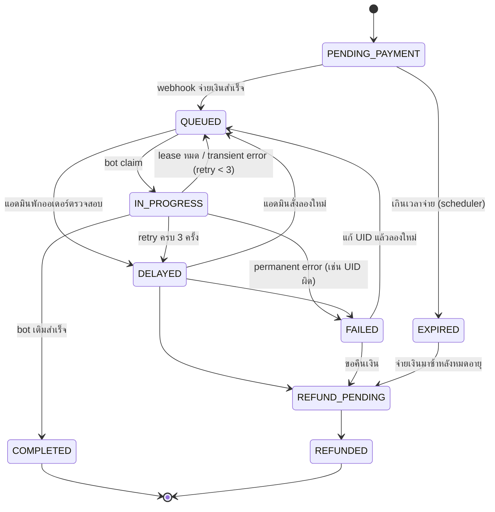

# State Machine & Schema

โค้ดจริงอยู่ที่ `src/domain/orderStatus.js` (ตารางด้านล่างต้องตรงกับโค้ด — มี test ตรวจ CHECK constraint ใน DB ให้)

| จาก | ไปได้ |
|---|---|
| PENDING_PAYMENT | QUEUED, EXPIRED |
| QUEUED | IN_PROGRESS, DELAYED |
| IN_PROGRESS | COMPLETED, QUEUED, DELAYED, FAILED |
| DELAYED | QUEUED, FAILED, REFUND_PENDING |
| FAILED | QUEUED, REFUND_PENDING |
| EXPIRED | REFUND_PENDING |
| REFUND_PENDING | REFUNDED |
| COMPLETED, REFUNDED | — (สถานะสุดท้าย) |

**แท็บ current** = PENDING_PAYMENT, QUEUED, IN_PROGRESS, DELAYED, FAILED, REFUND_PENDING (ยังมีใครต้องทำอะไรต่อ)
**แท็บ history** = COMPLETED, EXPIRED, REFUNDED

## ตาราง

| ตาราง | หน้าที่ | เคสที่เกี่ยวข้อง |
|---|---|---|
| `orders` | ออเดอร์ + `version`, `locked_by`, `lease_expires_at`, `retry_count`, `next_retry_at` | 1, 2, 4 |
| `order_events` | timeline (append-only) | ทุกเคส |
| `fulfillment_attempts` | รอบที่ bot จ่าย/เติม; partial unique index = จ่ายซ้อนไม่ได้ | 2, 4 |
| `processed_webhooks` | event id ที่ประมวลผลแล้ว | 3 |
| `idempotency_keys` | กันสร้างออเดอร์ซ้ำ + `request_hash` | — |
| `alerts` | แจ้งแอดมิน; `dedupe_key` unique ทำให้ scheduler รันซ้ำได้ | 1, 5 |

## ชั้นป้องกันใน DB (defense in depth)
- `orders_order_no_chk` — รูปแบบ `ORD-<13 หลัก>-<3 หลัก>`
- `orders_lock_pair_chk` / `orders_lock_status_chk` — lock ต้องมาเป็นคู่ และมีได้เฉพาะตอน IN_PROGRESS
- `uq_attempt_active_per_order` — ออเดอร์เดียวมีรายการ IN_FLIGHT/SUCCEEDED ได้ไม่เกิน 1
- `uq_orders_payment_ref` — เลขอ้างอิงการจ่ายเงินซ้ำข้ามออเดอร์ไม่ได้

## Bot API และการยืนยันตัวตน
- ทุก endpoint ใต้ `/bot` ต้องส่ง `X-Bot-Token` และ `X-Bot-Id`; ตั้งค่า token จาก `BOT_TOKEN`
- `POST /bot/orders/claim` ส่ง `X-Bot-Id` เพื่อระบุ worker; เลือกงานด้วย `FOR UPDATE SKIP LOCKED` ภายใน transaction; ถ้าไม่มีงานตอบ `{ "data": null }`
- `POST /bot/orders/:orderNo/heartbeat` ต่อ lease เฉพาะ bot ที่ถือ lease ซึ่งยังไม่หมดอายุ
- `POST /bot/orders/:orderNo/complete` ยืนยันงานสำเร็จ; `/fail` รับ body `{ "errorType": "TRANSIENT|PERMANENT", "errorCode": "...", "message": "..." }`
- ทั้ง heartbeat, complete และ fail ต้องส่ง `X-Bot-Id` ของ worker ที่ claim งานนั้น; การเรียกของ bot อื่นหรือ lease หมดอายุได้ `409 BOT_LEASE_NOT_OWNED`
- การเปลี่ยนสถานะผ่าน `applyTransition()` ซึ่งล็อกแถว ตรวจ state machine เพิ่ม `version` และเขียน timeline event ใน transaction เดียวกัน
- endpoint ใต้ `/admin` ต้องส่ง `X-Admin-Token` จาก `ADMIN_TOKEN`
- หากรันนอก Docker Compose แล้วยังไม่ตั้ง token endpoint ภายในตอบ `503 AUTH_NOT_CONFIGURED` แทนการเปิดให้เรียกโดยไม่มี auth (Compose ตั้งค่าเริ่มต้น `dev-*-change-me` ให้)
- ใส่ `BOT_TOKEN` และ `ADMIN_TOKEN` ที่คาดเดายากในไฟล์ `.env` ก่อนเรียก endpoint ภายใน; `.env` ถูก ignore และไม่ควร commit

## ใครเป็นคนทำให้สถานะเปลี่ยน (actor / event type)

| ทรานซิชัน | ตัวกระตุ้น | event type | actor | เคส |
|---|---|---|---|---|
| (สร้าง) -> PENDING_PAYMENT | POST /orders | ORDER_CREATED | customer | — |
| PENDING_PAYMENT -> QUEUED | webhook จ่ายเงิน | PAYMENT_CONFIRMED | webhook | 3 |
| PENDING_PAYMENT -> EXPIRED | scheduler | PAYMENT_EXPIRED | scheduler | 5 |
| EXPIRED -> REFUND_PENDING | webhook จ่ายช้า | LATE_PAYMENT_RECEIVED | webhook | 3 |
| QUEUED -> IN_PROGRESS | bot claim (SKIP LOCKED) | BOT_CLAIMED | bot:<id> | 2 |
| IN_PROGRESS -> COMPLETED | bot complete | BOT_COMPLETED | bot:<id> | — |
| IN_PROGRESS -> QUEUED | bot รายงาน transient / lease หมด (หน่วง backoff) | BOT_FAILED / LEASE_EXPIRED | bot:<id> / scheduler | 1, 4 |
| IN_PROGRESS -> DELAYED | retry ครบเพดานแล้วยังไม่สำเร็จ | RETRIES_EXHAUSTED | bot:<id> / scheduler | 1 |
| IN_PROGRESS -> FAILED | bot รายงาน permanent (เช่น UID ผิด) | BOT_FAILED | bot:<id> | 4 |
| FAILED -> QUEUED | ลูกค้าแก้ UID | UID_UPDATED | customer | 4 |
| FAILED / DELAYED -> QUEUED | แอดมิน requeue | ADMIN_REQUEUED | admin | 1 |
| FAILED / DELAYED -> REFUND_PENDING | ลูกค้าขอคืนเงิน | REFUND_REQUESTED | customer | 4 |
| REFUND_PENDING -> REFUNDED | แอดมินยืนยัน | REFUND_COMPLETED | admin | — |

เหตุการณ์ที่ **ไม่เปลี่ยนสถานะ** แต่บันทึกใน timeline: `ISSUE_REPORTED` (ลูกค้าแจ้งปัญหา)
`BOT_HEARTBEAT` เก็บในตารางไว้ตรวจสอบภายในแต่ **ไม่แสดง** ใน `GET /orders/:orderNo/timeline`

## นโยบาย retry (เคส 1)
ลองใหม่ได้ `BOT_MAX_RETRIES` (3) ครั้ง หน่วงก่อนครั้งที่ n = `RETRY_BASE_SECONDS * 2^(n-1)` (30, 60, 120 วินาที, ไม่เกิน `RETRY_MAX_DELAY_SECONDS`)
รอบที่ 4 พลาดอีก -> DELAYED + alert `BOT_RETRY_EXHAUSTED` (CRITICAL) ทั้ง "bot รายงาน transient" และ "lease หมด" นับรวมในเพดานเดียวกัน
